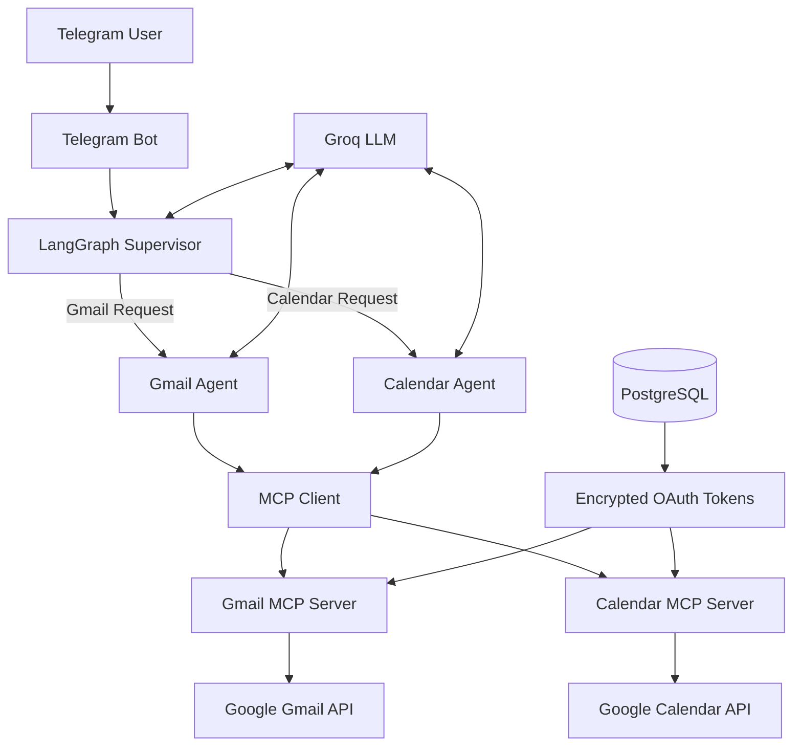

# 🤖 Mevert Plan Bot

### An Agentic AI Personal Assistant for Gmail & Google Calendar

**An intelligent personal assistant powered by Multi-Agent AI, Model Context Protocol (MCP), and Large Language Models.**


---

## 📖 About The Project

**Mevert Plan Bot** is an AI-powered personal assistant built using an **Agentic Multi-Agent Architecture**. It allows users to manage and access their Google Gmail and Google Calendar through natural-language conversations using a Telegram Bot.

The system uses a Supervisor Agent powered by LangGraph to understand user requests and intelligently route them to specialized AI agents.

These agents interact with external Google services through custom-built Model Context Protocol (MCP) servers, enabling the LLM to discover and execute relevant tools.

Instead of relying on predefined commands or traditional rule-based chatbot logic, Mevert Plan Bot uses LLM-powered reasoning and tool calling to determine how each request should be handled.

### 🎯 Project Objective

The goal is to build an intelligent personal assistant that connects conversational AI with everyday productivity applications, making email and calendar management easier through natural-language interaction.

---

## ✨ Key Features

### 🧠 Agentic AI & Multi-Agent Architecture

- Multi-agent architecture powered by LangGraph.
- Supervisor-based agent orchestration.
- Intelligent routing of user requests.
- Specialized Gmail and Calendar agents.
- LLM-powered reasoning and tool calling.

### 💬 Telegram Bot Integration

- Telegram Bot API integration for user interaction.
- Natural-language conversations through Telegram.
- Webhook-based message handling.
- Conversation history management.
- `/start`, `/help`, and `/reset` commands.
- AI-generated responses delivered directly to Telegram.

### 📧 Gmail Integration

- Search emails using AI-powered tool calling.
- Retrieve individual email details.
- Fetch unread emails.
- Access Gmail functionality through custom MCP tools.
- Google OAuth 2.0 authentication.

### 📅 Google Calendar Integration

- Retrieve upcoming calendar events.
- List available Google calendars.
- Access calendar information through Google Calendar API.
- Interact with Calendar through custom MCP tools.

### 🔌 Model Context Protocol (MCP)

- Custom Python MCP servers.
- Separate MCP servers for Gmail and Google Calendar.
- MCP client integration using LangChain MCP Adapters.
- Stdio-based communication between the application and MCP servers.
- Standardized tool discovery and invocation.

### 🔐 Authentication & Data Security

- Google OAuth 2.0 authentication.
- Encrypted OAuth token storage using Fernet.
- PostgreSQL-backed token persistence.
- Environment-based configuration for sensitive credentials.
- Telegram webhook secret-token validation.

---

## 🏗️ System Architecture

Mevert Plan Bot follows a modular architecture where Telegram acts as the conversational interface, LangGraph manages agent orchestration, and MCP servers connect specialized agents to external Google services.



### Architecture Components

| Component | Responsibility |
|---|---|
| Telegram Bot | Receives user messages and delivers AI-generated responses |
| Supervisor Agent | Understands user intent and selects the appropriate agent |
| Gmail Agent | Handles Gmail-related requests |
| Calendar Agent | Handles Google Calendar-related requests |
| Groq LLM | Provides language understanding, reasoning, and tool calling |
| LangGraph | Manages agent orchestration and workflow execution |
| MCP Client | Connects agents with MCP servers |
| Gmail MCP Server | Exposes Gmail operations as callable tools |
| Calendar MCP Server | Exposes Calendar operations as callable tools |
| PostgreSQL | Stores encrypted OAuth token data |
| Google APIs | Provide access to Gmail and Calendar services |

---

## 🔄 Multi-Agent Workflow

The application uses LangGraph to coordinate specialized AI agents through a Supervisor-based workflow.

### 1. User Interaction

The user sends a natural-language message through the Telegram Bot.

**Example:**

```text
Show me my unread emails.
```

### 2. Supervisor Agent

The Supervisor Agent analyzes the user's request using the Groq LLM and identifies which specialized agent should handle it.

### 3. Agent Routing

The Supervisor routes the request to the appropriate agent:

- Gmail Agent
- Calendar Agent

### 4. Tool Selection

The selected agent determines which MCP tool is required to complete the request.

### 5. MCP Tool Execution

The agent invokes the appropriate MCP tool through the MCP client.

### 6. Google API Interaction

The MCP server authenticates with Google services and retrieves the requested information.

### 7. Response Generation

The agent processes the tool response and generates a natural-language answer.

### 8. Telegram Response

The final response is delivered to the user through the Telegram Bot.

---

## 🔌 MCP (Model Context Protocol) Integration

Mevert Plan Bot uses custom Python MCP servers to expose Gmail and Google Calendar functionality as tools that AI agents can discover and invoke.

### 📧 Gmail MCP Server

| Tool | Description |
|---|---|
| `search_emails` | Searches Gmail messages |
| `get_email` | Retrieves individual email details |
| `get_unread_emails` | Retrieves unread email information |

### 📅 Google Calendar MCP Server

| Tool | Description |
|---|---|
| `list_calendars` | Retrieves available Google calendars |
| `get_upcoming_events` | Retrieves upcoming calendar events |

### MCP Communication

The application uses `MultiServerMCPClient` from LangChain MCP Adapters to connect to the custom MCP servers.

The MCP servers run as subprocesses using **stdio transport**, keeping external service integrations separate from the agent orchestration layer.

This modular design makes it easier to add new MCP servers and expose additional tools to the AI agents.

---

## 🛠️ Technology Stack

| Technology | Purpose |
|---|---|
| Python 3.12 | Backend development |
| LangChain | LLM integration and tool binding |
| LangGraph | Multi-agent orchestration |
| Groq | LLM inference |
| Model Context Protocol | Standardized tool integration |
| LangChain MCP Adapters | MCP client implementation |
| Telegram Bot API | Conversational user interface |
| Google Gmail API | Email integration |
| Google Calendar API | Calendar integration |
| Google OAuth 2.0 | Authentication |
| PostgreSQL | Persistent data storage |
| SQLAlchemy | Database ORM |
| Fernet | OAuth token encryption |
| Render | Cloud deployment |

---

## 📂 Project Structure

```text
mevert-plan-bot/
│
├── app/
│   │
│   ├── core/
│   │   └── config.py
│   │
│   ├── auth/
│   │   ├── google_auth.py
│   │   └── token_encryption.py
│   │
│   ├── database/
│   │   ├── base.py
│   │   ├── connection.py
│   │   ├── init_db.py
│   │   ├── token_repository.py
│   │   └── models/
│   │
│   ├── mcp_servers/
│   │   ├── google_gmail_mcp.py
│   │   └── google_calender_mcp.py
│   │
│   ├── mcp_client/
│   │   └── google_client.py
│   │
│   ├── agents/
│   │
│   └── telegram/
│       └── bot.py
│
├── tests/
│
├── workflow.py
├── requirements.txt
├── runtime.txt
├── .python-version
├── .env.example
├── .gitignore
└── README.md
```

---

## ⚙️ Getting Started

Follow these steps to run Mevert Plan Bot locally.

### Prerequisites

Make sure you have:

- Python 3.12
- Google Cloud account
- Gmail API enabled
- Google Calendar API enabled
- Telegram Bot Token
- Groq API Key
- PostgreSQL database

### 1. Clone the Repository

```bash
git clone https://github.com/YOUR_USERNAME/mevert-plan-bot.git

cd mevert-plan-bot
```

### 2. Create a Virtual Environment

```bash
python -m venv venv
```

**Windows:**

```bash
venv\Scripts\activate
```

**Linux / macOS:**

```bash
source venv/bin/activate
```

### 3. Install Dependencies

```bash
pip install -r requirements.txt
```

### 4. Configure Environment Variables

Create a `.env` file in the project root and add the required configuration values.

Refer to the [Environment Configuration](#-environment-configuration) section.

### 5. Configure Google OAuth

1. Open Google Cloud Console.
2. Create a Google Cloud project.
3. Enable Gmail API and Google Calendar API.
4. Configure the OAuth consent screen.
5. Create an OAuth 2.0 Desktop Application credential.
6. Download the credentials JSON file.
7. Save it as `credentials.json` in the project root.
8. Authorize your Google account.

### Required OAuth Scopes

```text
https://www.googleapis.com/auth/gmail.modify

https://www.googleapis.com/auth/calendar.events

https://www.googleapis.com/auth/calendar.calendarlist.readonly
```

### 6. Initialize PostgreSQL Database

After configuring the database connection, run:

```bash
python -m app.database.init_db
```

### 7. Configure Telegram Bot

1. Open Telegram.
2. Find `@BotFather`.
3. Create a new bot using `/newbot`.
4. Copy the generated bot token.
5. Add the token to your `.env` file.

### 8. Run the Application

```bash
python -m app.telegram.bot
```

For local webhook development, configure a publicly accessible HTTPS endpoint for Telegram.

---

## 🔑 Environment Configuration

Create a `.env` file in the root directory:

```env
# PostgreSQL Database
DATABASE_URL=your_postgresql_connection_string

# Google OAuth Credentials
GOOGLE_CLIENT_ID=your_google_client_id
GOOGLE_CLIENT_SECRET=your_google_client_secret
GOOGLE_ACCOUNT_EMAIL=your_google_account_email

# Encryption
FERNET_KEY=your_fernet_encryption_key

# Groq LLM
GROQ_API_KEY=your_groq_api_key
MODEL_NAME=your_groq_model_name

# Telegram Bot
TELEGRAM_BOT_TOKEN=your_telegram_bot_token
WEBHOOK_SECRET_TOKEN=your_webhook_secret
```

**Security Note:** Never commit `.env`, `credentials.json`, OAuth tokens, or database passwords to GitHub.

---

## ☁️ Deployment

Mevert Plan Bot is designed to run as a Render Web Service using Telegram webhooks.

### Deployment Configuration

**Build Command:**

```bash
pip install -r requirements.txt
```

**Start Command:**

```bash
python -m app.telegram.bot
```

### Deployment Steps

1. Push the project to GitHub.
2. Create a new Web Service on Render.
3. Connect your GitHub repository.
4. Configure the build and start commands.
5. Add the required environment variables in Render.
6. Configure the PostgreSQL database connection.
7. Deploy the application.
8. Verify successful Telegram webhook configuration.
9. Send a test message to your Telegram Bot.

The application uses Render's service URL and port configuration to register and run the Telegram webhook.

---

## 🔐 Security

Security is an important part of the application's architecture.

- **Google OAuth 2.0:** Authenticates access to Google services.
- **Fernet Encryption:** Encrypts OAuth tokens before storing them in PostgreSQL.
- **Environment Variables:** Keeps API keys and sensitive credentials outside the source code.
- **PostgreSQL Persistence:** Stores authentication data persistently.
- **Webhook Validation:** Uses Telegram's secret-token validation for webhook requests.

Sensitive operations should be protected by backend-enforced approval checks before execution.

---

## 🎯 Project Vision

Mevert Plan Bot demonstrates how Agentic AI can be used to build practical personal productivity assistants.

By combining LLM-powered reasoning, multi-agent orchestration, MCP-based tool integration, secure authentication, and external APIs, the project connects conversational AI with everyday productivity applications.

The aim is to create an assistant that can understand user intent, coordinate specialized agents, and simplify everyday tasks through a single conversational interface.


<p align="center">
  ⭐ If you find this project interesting, consider giving the repository a star!
</p>
